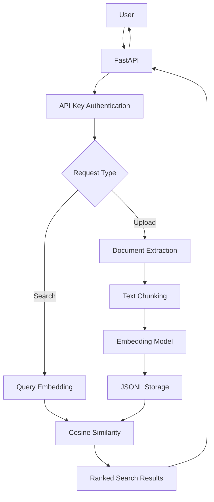

# Semantic Document Search API

A semantic document search application built with Python, FastAPI, Sentence Transformers and NumPy. It extracts text from PDF, Word and TXT documents, divides the content into chunks, generates embeddings and retrieves relevant content using cosine similarity.

## Features

- Semantic search using sentence embeddings.
- Supports PDF, DOCX and TXT documents.
- Text extraction and chunking.
- Cosine similarity-based retrieval.
- Search filters: source, document type and minimum score.
- FastAPI endpoints for search and document management.
- API key authentication.
- Document upload, indexing and deletion.
- Retrieval evaluation using Hit@1, Hit@3, Hit@5 and MRR.
- Automated API tests using pytest.

## Technology Stack

| Technology | Purpose |
|---|---|
| Python | Core programming language |
| FastAPI | REST API |
| Sentence Transformers | Text embeddings |
| all-MiniLM-L6-v2 | Embedding model |
| NumPy | Vector similarity calculations |
| PyMuPDF | PDF text extraction |
| python-docx | Word document extraction |
| Pydantic | Request validation |
| pytest | API testing |

## Architecture



## Project Structure

```text
Week6-Day5/
│
├── main.py
├── schemas.py
├── search.py
├── auth.py
├── extract.py
├── chunking.py
├── requirements.txt
├── .env
├── .gitignore
│
├── data/
│   └── chunks.jsonl
│
├── scripts/
│   └── measure_latency.py
│
├── evaluation/
│   ├── queries.json
│   ├── evaluate.py
│   ├── query_results.csv
│   ├── worst_queries.csv
│   └── experiment_results.csv
│
└── tests/
    ├── conftest.py
    └── test_api.py
```

## Installation and Setup

### 1. Clone the repository

```bash
git clone YOUR_GITHUB_REPOSITORY_URL
cd Week6-Day5
```

### 2. Create a virtual environment

```bash
python -m venv .venv
```

### 3. Activate the environment

Windows PowerShell:

```powershell
.venv\Scripts\Activate.ps1
```

### 4. Install dependencies

```bash
python -m pip install -r requirements.txt
```

### 5. Configure environment variables

Create a `.env` file:

```env
API_KEY=your_secret_api_key
MODEL_NAME=sentence-transformers/all-MiniLM-L6-v2
```

Use your own API key value. This is an application authentication key, not an OpenAI API key.

### 6. Run the application

```bash
python -m uvicorn main:app --reload
```

API documentation:

```text
http://127.0.0.1:8000/docs
```

## How to Index Documents

1. Start the FastAPI application.
2. Open `/docs`.
3. Select `POST /documents`.
4. Upload a PDF, DOCX or TXT file.
5. The application extracts the text and divides it into chunks.
6. Embeddings are generated and stored in the local JSONL file.

The indexed chunks are stored in:

```text
data/chunks.jsonl
```

## API Examples

All protected endpoints require the `x-api-key` header.

### 1. Health Check

```http
GET /health
```

### 2. List Documents

```http
GET /documents
```

### 3. Search Documents

```http
POST /search
```

Request:

```json
{
  "query": "How can I reset my password?",
  "top_k": 5
}
```

Example PowerShell request:

```powershell
$headers = @{
    "x-api-key" = "your_secret_api_key"
}

$body = @{
    query = "How can I reset my password?"
    top_k = 5
} | ConvertTo-Json

Invoke-RestMethod `
    -Uri "http://127.0.0.1:8000/search" `
    -Method POST `
    -Headers $headers `
    -ContentType "application/json" `
    -Body $body
```

The response contains ranked results with source, page, section, similarity score and text.

### 4. Upload a Document

```http
POST /documents
```

Upload a supported PDF, DOCX or TXT file using multipart form data.

### 5. Delete a Document

```http
DELETE /documents/{source}
```

Example:

```text
DELETE /documents/leave_policy.pdf
```

## API Testing

Run the tests:

```bash
python -m pytest -v
```

Test coverage includes:

- Health endpoint.
- Search endpoint.
- Invalid `top_k` validation.
- Missing API key.
- Document upload.
- Document deletion.

**Recorded test result:** 6 tests passed.

## Retrieval Evaluation

The system was evaluated using 20 queries across three sample documents.

| Metric | Result |
|---|---:|
| Total queries | 20 |
| Hit@1 | 0.90 |
| Hit@3 | 1.00 |
| Hit@5 | 1.00 |
| MRR | 0.95 |

### Evaluation Observations

- 18 out of 20 expected results appeared at rank 1.
- All 20 expected results appeared within the top 3.
- Queries 3 and 5 returned the expected result at rank 2.
- The other 18 queries returned the expected result at rank 1.

### Worst Query Analysis

| Query | Correct Rank | Reciprocal Rank |
|---|---:|---:|
| Who should receive a leave application? | 2 | 0.50 |
| When should employees submit leave requests? | 2 | 0.50 |

The third entry in the generated worst-query report was a rank-1 query tied with other successful queries. It was not a genuinely poor retrieval result.

### Experiment Configuration

| Setting | Config A |
|---|---|
| Chunk size | 500 |
| Overlap | 100 |
| Embedding model | all-MiniLM-L6-v2